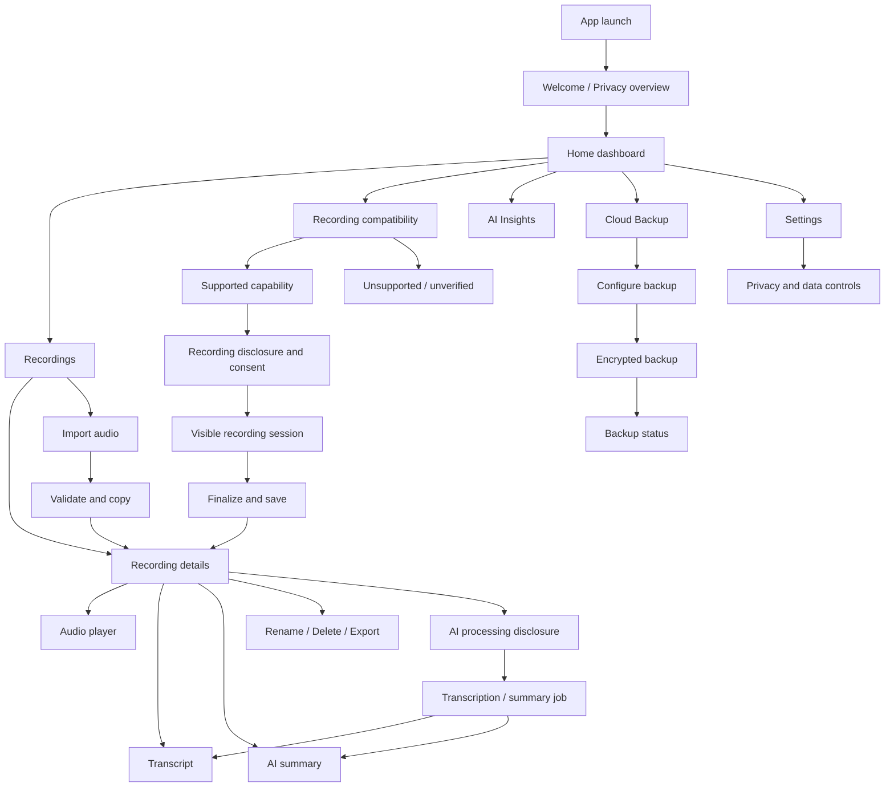

# CallVault — Application Flow

**Version:** 0.1  
**Primary client:** Android  
**Companion client:** Web dashboard

## 1. Navigation map

## 2. First launch

1. Show CallVault welcome screen.
2. Explain the app's purpose and privacy model.
3. State that SIM and third-party VoIP recording may be unsupported.
4. Explain local storage and optional cloud processing.
5. Continue to Home.
6. Request permissions only when the user invokes a feature that needs them.

Do not request all permissions on first launch.

## 3. Home dashboard

Display:
- Recording/library item count.
- Total local audio duration.
- Local storage usage.
- Recent items.
- Capability status entry point.
- AI processing queue, if any.
- Backup status, if configured.

For a new user, show an empty state with:
- Import audio action.
- Check device compatibility action.
- Short explanation of supported recording limitations.

## 4. Recording capability flow

1. User opens “Recording compatibility”.
2. App explains that call-state detection and call-audio access are different.
3. App displays separate rows for cellular SIM and third-party VoIP.
4. Each row uses one of: Supported, Unsupported, Unverified.
5. If unsupported, explain that the platform/app does not expose a permitted capture method.
6. If supported on a tested configuration, show the exact tested device/OS/source and required disclosures.
7. User can proceed only through the permitted recording flow.

No “Start recording” control should be displayed as active for an unsupported source.

## 5. Import audio flow

1. User taps Import.
2. Android system file picker opens.
3. User selects an audio file.
4. App validates file type, size and readability.
5. App obtains duration and metadata.
6. App copies the file into app-private storage if required.
7. App verifies the copied file.
8. App creates a library item with source `IMPORTED`.
9. User opens the item and plays it.

## 6. Recording session flow

Only available when a legitimate, tested capture path exists:
1. Explain what audio will be captured and when.
2. Obtain required participant/user consent and permissions.
3. Start a visible user-controlled session.
4. Show persistent recording status/notification as required by platform.
5. Provide a clear stop action.
6. Finalize and validate the audio file.
7. Persist metadata.
8. Show the recording detail screen.

If capture fails, do not create a completed recording entry. Show a recoverable failure and diagnostic category.

## 7. Recording detail flow

Sections:
- Header: title, date/time, duration, source label.
- Player: play/pause, seek, elapsed/total time.
- Transcript: available, processing, failed or not requested.
- Summary: available, processing, failed or not requested.
- Actions: rename, export/share, delete, request transcription, request summary, back up.

## 8. AI processing flow

1. User taps Transcribe or Summarize.
2. Show a disclosure that identifies the selected audio and explains cloud processing.
3. User confirms.
4. Show queued/uploading/processing states.
5. Allow cancellation where provider/job supports it.
6. Display result and mark it AI-generated.
7. Allow retry or delete.

## 9. Backup flow

1. User opens Backup.
2. Explain encryption, key recovery and provider storage.
3. User opts in and completes setup.
4. User chooses whether to back up all eligible items or selected items.
5. App encrypts locally.
6. Upload starts.
7. Display progress and result.
8. Restore is initiated by user and decrypted on device.

## 10. Delete flow

- Delete local audio: confirm and remove file plus related local metadata according to retention policy.
- Delete transcript/summary: remove derived data.
- Delete cloud backup: issue server deletion and show pending/complete status.
- Delete account: explain effects and confirm; remove or anonymize associated backend data as legally required.

## 11. Web companion flow

1. User signs in.
2. Dashboard shows only synchronized data.
3. User opens a recording.
4. Web app requests authorized access to encrypted/available audio or supported playback stream.
5. Transcript and summary are displayed.
6. User can manage synchronized metadata and backup settings.
7. Web app never claims to record calls.

## 12. Global UI states

Every network- or file-backed screen must account for:
- Loading.
- Empty.
- Success.
- Offline.
- Permission denied.
- Unsupported capability.
- Processing.
- Retryable failure.
- Permanent failure.
- Deleted/missing file.
- Authentication expired.
