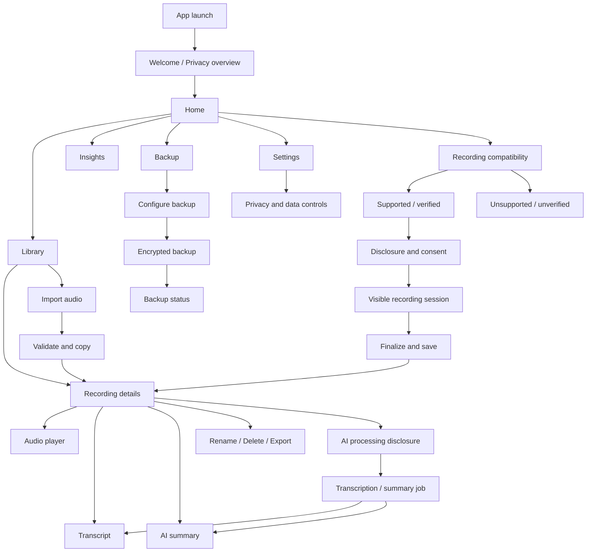

# CallVault — Application Flow

**Version:** 1.0  
**Primary client:** Android  
**Companion client:** Web dashboard  
**Navigation labels:** Home, Library, Insights, Backup, Settings

## 1. Navigation map

## 2. First launch

1. Show CallVault welcome screen.
2. Explain app purpose and privacy model.
3. State SIM and third-party VoIP recording may be unsupported.
4. Explain local storage and optional cloud processing.
5. Continue to Home.
6. Request permissions only when user invokes a feature that needs them.

Do not request all permissions on first launch.

## 3. Primary navigation

Five destinations:
1. Home.
2. Library (feature package remains `feature.recordings`).
3. Insights (AI Insights in detailed copy).
4. Backup.
5. Settings.

The bottom navigation is persistent on primary destinations. Secondary screens such as Recording Details and Full Player may use their own top app bars and navigation behavior.

## 4. Home dashboard

Display:
- Library item count.
- Total local audio duration.
- Local storage usage.
- Recent items.
- Recording compatibility entry point.
- AI preview only when actual generated insights exist.
- Backup status only when backup is configured.
- Import action.

For a new user, show an empty state with:
- Import audio action.
- Check device compatibility action.
- Short explanation of recording limitations.

Do not show a recording-now indicator unless a real permitted session is active. Do not show a mini-player unless real media is playing.

### First Home milestone
- Header: CallVault branding, greeting and profile action.
- Overview: local item count, total duration and storage usage.
- Quick actions: Import audio and Recording compatibility.
- Recent recordings.
- AI insights preview when available.
- Mini-player when active.
- Bottom navigation.

Development fixtures may be used temporarily but must be visibly identified in development and excluded from production.

## 5. Recording compatibility flow

1. User opens Recording compatibility.
2. App explains call-state detection and call-audio access are different.
3. App displays separate rows for cellular SIM and third-party VoIP.
4. Each row is Supported (verified), Unsupported or Unverified.
5. Unsupported explains platform/source limitations.
6. Supported states identify exact tested device/OS/source and required disclosures.
7. User proceeds only through permitted recording flow.

No active Start Recording control for unsupported or unverified source.

## 6. Import audio flow

1. User taps Import.
2. Android system picker opens through Storage Access Framework.
3. User selects an audio file.
4. App validates type, size and readability.
5. App obtains duration and metadata.
6. App copies into app-private storage if required.
7. App verifies copied file.
8. App creates library item with source `IMPORTED`.
9. User opens item and plays it.

## 7. Recording session flow

Only available when legitimate tested capture path exists:
1. Explain what audio is captured and when.
2. Obtain required participant/user consent and permissions.
3. Start visible user-controlled session.
4. Show persistent recording status/notification as required.
5. Provide clear stop action.
6. Finalize and validate audio file.
7. Persist metadata.
8. Show Recording Details.

If capture fails, do not create completed recording entry. Show recoverable failure and diagnostic category.

## 8. Library flow

- Show local recordings and imported audio.
- Search by supported metadata fields.
- Sort/filter by date, source and status.
- Distinguish source type and verification.
- Open item details.
- Offer rename, delete and user-mediated export/share.

Transcript search is enabled only after transcript data exists and the corresponding search implementation is built.

## 9. Recording detail and player

Details:
- Title, date/time, duration and source label.
- Playback controls and progress.
- Transcript state: not requested, processing, available or failed.
- Summary state: not requested, processing, available or failed.
- Actions: rename, export/share, delete, transcribe, summarize, back up.

Full player:
- Play/pause, seek, elapsed/total duration.
- Playback speed and skip controls only when implemented.
- Transcript navigation and timestamp seeking only when timestamp data is available.
- Mini-player reflects actual playback state.

## 10. AI processing flow

1. User taps Transcribe or Summarize.
2. Show disclosure identifying selected audio and cloud processing destination.
3. User confirms.
4. Show queued/uploading/processing states.
5. Allow cancellation where provider/job supports it.
6. Display result and mark AI-generated.
7. Allow retry or delete.

## 11. Insights flow

- List available transcripts and summaries.
- Show source recording link.
- Display overview, key points, decisions and action items when generated.
- Clearly label generated content.
- Provide transcript search only when implemented.
- Do not imply summaries exist for unprocessed audio.

## 12. Backup flow

1. User opens Backup.
2. Explain encryption, key recovery and provider storage.
3. User opts in and completes setup.
4. User chooses all eligible items or selected items.
5. App encrypts locally.
6. Upload starts.
7. Display progress and result.
8. Restore is initiated by user and decrypted locally.

## 13. Settings and privacy

Sections:
- Appearance.
- Recording compatibility/preferences.
- Notifications.
- AI processing preferences.
- Backup/encryption.
- Storage/retention.
- Permissions.
- Privacy policy.
- Export data.
- Delete data/account.

## 14. Delete flow

- Delete local audio: confirm and remove file plus related local metadata according to retention policy.
- Delete transcript/summary: remove derived data.
- Delete cloud backup: request server deletion and show pending/complete status.
- Delete account: explain effects and confirm; remove/anonymize associated backend data as legally required.

## 15. Web companion flow

1. User signs in.
2. Dashboard shows synchronized data only.
3. User opens a recording.
4. Web app requests authorized access to encrypted/available audio or supported playback stream.
5. Transcript and summary are displayed.
6. User manages synchronized metadata and backup settings.
7. Web app never claims to record calls.

## 16. Global UI states

Every network/file-backed screen must account for:
- Loading.
- Empty.
- Success.
- Offline.
- Permission denied.
- Unsupported capability.
- Unverified capability.
- Processing.
- Retryable failure.
- Permanent failure.
- Deleted/missing file.
- Authentication expired.
