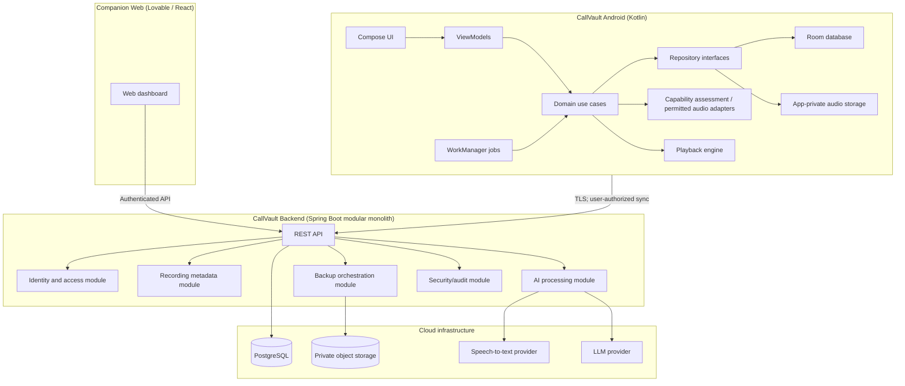

# CallVault — System Architecture

**Version:** 0.1  
**Architecture style:** Android-first hybrid, local-first client, modular backend monolith

## 1. Architecture goals

- Keep native audio/device functionality inside Android.
- Keep core library and playback usable offline.
- Separate UI, business rules and persistence.
- Keep backend scope small until actual cloud needs are established.
- Make web and Android clients consume the same backend contracts.
- Avoid creating a microservice system before there is an operational reason.
- Design privacy and encryption into data flows.

## 2. High-level system

## 3. Android application

### Presentation
- Jetpack Compose screens.
- Navigation Compose.
- ViewModels expose immutable UI state (StateFlow).
- UI events are sent to ViewModels.
- UI does not access Room, files or network clients directly.

### Domain
- Use cases for importing audio, listing recordings, playback control, deleting items, requesting transcription, requesting summaries and managing backup.
- Domain models are independent of Room and API DTOs.
- Repository interfaces define boundaries.

### Data
- Room DAOs and entities.
- File storage repository.
- API data sources.
- Mappers between entities, domain models and API DTOs.
- Preferences and settings repository.

### Audio subsystem
Separate the following concepts:
1. Call-state observation (metadata only).
2. Recording capability assessment.
3. Actual audio capture through an allowed mechanism.
4. Imported audio.
5. Playback.

Never infer audio capture availability from call-state events. A call being active does not grant access to the call's internal audio.

### Background work
WorkManager may handle deferred backup and transcription requests. It is not a mechanism for continuous covert recording or bypassing foreground-service/background restrictions.

## 4. Backend

Start as a modular Spring Boot application with internal modules/packages:
- identity
- recordings
- transcription
- summaries
- backup
- audit
- shared configuration/security

Use REST APIs and OpenAPI. Use PostgreSQL for structured metadata. Use private object storage for encrypted audio objects. Do not store audio blobs in PostgreSQL.

Split into services only when independent scaling, deployment, ownership or reliability requirements justify the operational complexity.

## 5. Web companion

Lovable generates a React/TypeScript web client. It is not the Android application and cannot access Android call audio. It may:
- Show synchronized recordings and metadata.
- Play audio only when the user has synchronized and authorized access.
- Show transcripts and summaries.
- Manage backup and account settings.

It must not create fake recording controls that imply the browser can record cellular or WhatsApp calls.

## 6. Data flow: local import

1. User chooses an audio file using Android's Storage Access Framework.
2. App validates supported format and size.
3. App copies or references the content safely in app-private storage according to product policy.
4. App extracts duration/format metadata.
5. App creates a local recording record with source type `IMPORTED`.
6. Library refreshes.
7. Playback uses the local file reference.

## 7. Data flow: permitted recording

1. User views capability and privacy explanation.
2. App verifies the source and recording mechanism are supported.
3. User starts recording through a visible control or a permitted, disclosed automatic rule.
4. App displays recording state and stop control.
5. Audio is written to app-private storage.
6. On stop, file is finalized and validated.
7. Metadata is persisted.
8. The recording appears in the library.

If no permitted audio source exists, the operation must fail closed and show an explanatory unsupported state.

## 8. Data flow: AI transcription

1. User selects a recording.
2. App explains that audio will be sent to the configured processor and describes relevant data handling.
3. User explicitly confirms.
4. App creates a processing job.
5. Audio is encrypted in transit; upload is authorized and time-limited.
6. Backend invokes the speech-to-text provider.
7. Transcript and timestamps are persisted.
8. App fetches and displays result.
9. User may delete transcript and request deletion of provider-side data where supported by provider terms.

## 9. Data flow: encrypted backup

1. User enables backup and completes key setup.
2. Android encrypts audio locally using a per-file data encryption key.
3. Data encryption key is wrapped by a user/device-controlled key-encryption scheme.
4. Only ciphertext is uploaded to private object storage.
5. Backend stores object metadata and integrity hashes.
6. Restore downloads ciphertext, verifies integrity and decrypts locally.
7. If key recovery is unavailable, the app must clearly explain that backups may be unrecoverable.

Key derivation, recovery and multi-device key sharing require a separate security design review before implementation.

## 10. Security boundaries

- Android Keystore protects cryptographic key material where supported.
- Audio files remain app-private by default.
- Backend credentials and AI provider secrets never ship in the mobile or web client.
- All network communication uses TLS.
- Access tokens are stored using secure platform storage.
- Object storage is private; use short-lived authorized access.
- Audit logs must avoid recording transcript/audio contents.
- Logs must redact tokens, secrets and sensitive content.

## 11. Reliability and offline behavior

Offline:
- View local library.
- Play local files.
- Rename/delete local metadata and files.
- Search local metadata and any locally stored transcripts.

Online:
- Request cloud transcription/summaries.
- Upload/download encrypted backup.
- Synchronize account metadata.

Queue network-dependent work with explicit status, retry limits and cancellation.

## 12. Architecture decisions

| Decision | Choice | Rationale |
|---|---|---|
| Native client | Kotlin + Compose | Native Android integration |
| Architecture | MVVM + Clean Architecture boundaries | Testability and separation |
| Local DB | Room | Structured offline metadata |
| Backend | Spring Boot modular monolith | Lower operational complexity |
| Cloud DB | PostgreSQL | Structured relational data |
| Audio storage | Private object storage | Avoid large blobs in relational DB |
| Web | Lovable-generated React client | Rapid companion UI |
| Sync | Explicit user-controlled sync | Privacy and bandwidth control |
