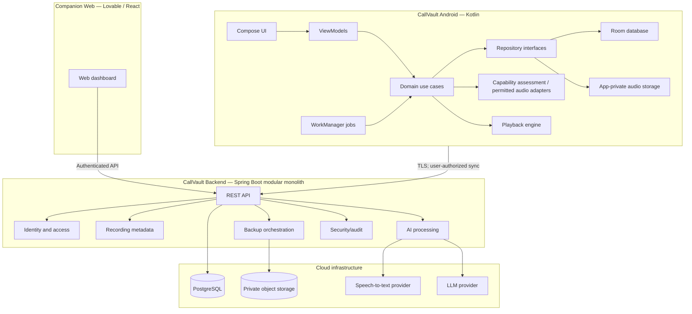

# CallVault — System Architecture

**Version:** 1.0  
**Architecture style:** Android-first hybrid, local-first client, modular backend monolith  
**Status:** Target architecture; implementation is incremental

## 1. Architecture goals

- Keep native audio/device functionality inside Android.
- Keep core library and playback usable offline.
- Separate UI, business rules and persistence.
- Keep backend scope small until cloud needs are established.
- Make web and Android clients consume the same backend contracts.
- Avoid premature microservices.
- Design privacy and encryption into data flows.
- Never imply that a browser or call-state API grants access to call audio.

## 2. High-level system

## 3. Android application

### Presentation
- Jetpack Compose and Material 3.
- Navigation Compose is the planned navigation library; verify dependency/version before adding.
- ViewModels expose immutable UI state (StateFlow).
- UI events are sent to ViewModels.
- UI does not access Room, files or network clients directly.

### Domain
Use cases are planned for importing audio, listing/searching recordings, playback control, deleting items, requesting transcription/summaries and managing backup. Domain models remain independent of Room entities and API DTOs. Repository interfaces define boundaries.

### Data
- Room DAOs/entities (planned).
- App-private file storage.
- API data sources (future cloud phase).
- Mappers between entities, domain models and API DTOs.
- Preferences/settings repository.

### Current Android code organization

The user-created project currently uses one Gradle module, `:app`, and package folders beneath `dev.callvault.app`. The screenshot shows:
- `core.designsystem.components`
- `core.designsystem.theme`
- `data.local`
- `data.mapper`
- `data.repository`
- `domain.model`
- `domain.repository`
- `domain.usecase`
- `feature.home`
- `feature.recordings`
- `feature.player`
- `feature.insights`
- `feature.backup`
- `feature.settings`
- Generated `ui.theme` still exists.
- `MainActivity.kt`.

This is the observed package baseline, not proof that each layer contains implementation. The target may add subpackages such as local/dao, local/database and local/entity, plus core/navigation and core/common. Do not create Gradle modules unless a later decision justifies them.

### Audio subsystem

Keep these concepts separate:
1. Call-state observation (metadata only).
2. Recording capability assessment.
3. Actual audio capture through an allowed mechanism.
4. Imported audio.
5. Playback.

A call being active does not grant access to internal call audio. Only a tested, permitted source adapter may create a CallVault-recorded item.

### Background work
WorkManager may handle eligible deferred backup/transcription jobs. It is not a mechanism for continuous covert recording or bypassing foreground-service/background restrictions.

## 4. Backend

Start as a modular Spring Boot application with internal modules/packages:
- identity
- recordings
- transcription
- summaries
- backup
- audit
- shared configuration/security

Use REST APIs and OpenAPI. Use PostgreSQL for structured metadata. Use private object storage for encrypted audio objects. Do not store audio blobs in PostgreSQL.

Split into services only when independent scaling, deployment, ownership or reliability requirements justify operational complexity.

## 5. Web companion

Lovable generates a React/TypeScript web client. It is not the Android application and cannot access Android call audio. It may:
- Show synchronized recordings and metadata.
- Play audio only when the user has synchronized and authorized access.
- Show transcripts and summaries.
- Manage backup and account settings.

It must not create fake recording controls implying the browser can record cellular or third-party VoIP calls.

## 6. Data flow — local import

1. User chooses an audio file using Android Storage Access Framework.
2. App validates supported format and size.
3. App copies or safely references content in app-private storage according to product policy.
4. App extracts duration/format metadata.
5. App creates a local item with source type `IMPORTED`.
6. Library refreshes.
7. Playback uses the local file reference.

## 7. Data flow — permitted recording

1. User views capability and privacy explanation.
2. App verifies source and capture mechanism are supported.
3. User starts through visible control or permitted disclosed automatic rule.
4. App displays recording state and stop control.
5. Audio is written to app-private storage.
6. On stop, file is finalized and validated.
7. Metadata is persisted.
8. Item appears in library.

If no permitted source exists, fail closed and show an explanatory unsupported/unverified state.

## 8. Data flow — AI transcription

1. User selects a recording.
2. App explains destination and processing/data handling.
3. User explicitly confirms.
4. App creates a processing job.
5. Audio is transmitted over TLS using authorized, time-limited upload.
6. Backend invokes selected speech-to-text provider.
7. Transcript/timestamps are persisted according to approved privacy design.
8. App fetches and displays result.
9. User may delete transcript and request provider-side deletion where supported.

## 9. Data flow — encrypted backup

1. User enables backup and completes key setup.
2. Android encrypts audio locally using a per-file data encryption key.
3. The data key is wrapped using an approved user/device-controlled key-encryption design.
4. Only ciphertext is uploaded to private object storage.
5. Backend stores object metadata and integrity hashes.
6. Restore downloads ciphertext, verifies integrity and decrypts locally.
7. If key recovery is unavailable, explain that backups may be unrecoverable.

Key derivation, recovery and multi-device sharing require a separate security design review before implementation.

## 10. Security boundaries

- Android Keystore protects cryptographic key material where supported.
- Audio files remain app-private by default.
- Backend credentials and AI provider secrets never ship in mobile/web clients.
- All network communication uses TLS.
- Access tokens use secure platform storage.
- Object storage is private; use short-lived authorized access.
- Audit logs avoid transcript/audio contents.
- Logs redact tokens, secrets and sensitive content.

## 11. Offline behavior

Offline:
- View local library.
- Play local files.
- Rename/delete local metadata and files.
- Search local metadata and locally stored transcripts.

Online:
- Request cloud transcription/summaries.
- Upload/download encrypted backup.
- Synchronize account metadata.

Queue network-dependent work with explicit status, retry limits and cancellation.

## 12. Architecture decisions

| Decision | Choice | Status |
|---|---|---|
| Native client | Kotlin + Compose | Confirmed |
| Android organization | Single :app module; package boundaries | Confirmed current baseline |
| UI architecture | MVVM + Clean Architecture boundaries | Confirmed |
| Local DB | Room | Approved target; not integrated |
| Backend | Spring Boot modular monolith | Confirmed direction |
| Cloud DB | PostgreSQL | Confirmed direction |
| Audio storage | Private object storage | Confirmed direction |
| Web | Lovable-generated React client | Confirmed direction |
| Sync | Explicit user-controlled sync | Confirmed direction |

## 13. Architecture risks/open decisions

- Permitted call-audio capture for each target source/device.
- Exact foreground-service and permission requirements if any recording adapter qualifies.
- Room/Media3/Navigation dependency versions.
- Backup key recovery and multi-device model.
- AI provider and data retention.
- Authentication model and cloud authorization.
