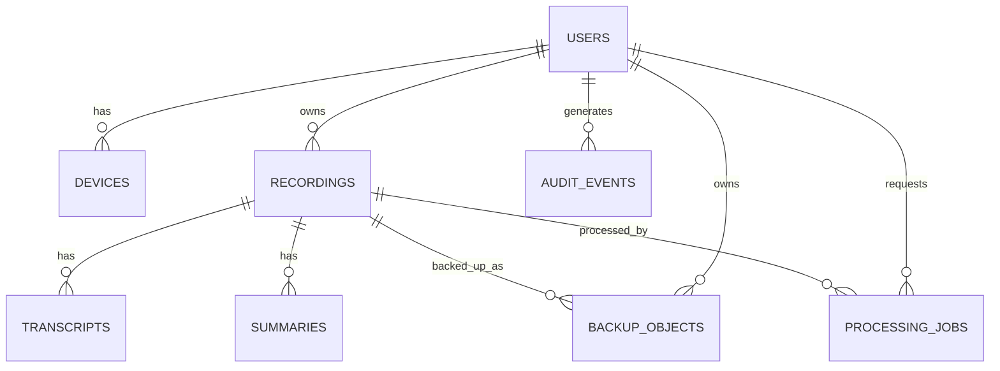

# CallVault — Backend Schema and API Data Model

**Version:** 1.0  
**Database:** PostgreSQL  
**Backend:** Spring Boot modular monolith  
**Status:** Proposed logical model and DDL; not implemented or migration-tested

## 1. Schema principles

- Store metadata and job state in PostgreSQL.
- Store encrypted audio objects in private object storage, never as large database blobs.
- Every user-owned record has an owner identifier.
- Enforce ownership in backend authorization checks, not only UI filters.
- Use UUID primary keys.
- Use UTC timestamps (`TIMESTAMPTZ`).
- Store minimum necessary personal data.
- Do not store plaintext audio or full transcripts in audit logs.
- Audio uploaded for backup must be client-side encrypted.
- Distinguish recordings from imported files.
- The schema is a proposal, not a production migration.

## 2. Entity relationships



### Core entities
- `users`: cloud identity/profile.
- `devices`: registered client devices.
- `recordings`: metadata for recorded or imported audio.
- `transcripts`: transcript text and optional timestamped segments.
- `summaries`: generated overview, key points, decisions and action items.
- `processing_jobs`: transcription/summary processing lifecycle.
- `backup_objects`: encrypted object metadata and backup state.
- `audit_events`: safe security/action metadata.

## 3. PostgreSQL DDL proposal

```sql
CREATE EXTENSION IF NOT EXISTS pgcrypto;

CREATE TABLE users (
    id UUID PRIMARY KEY DEFAULT gen_random_uuid(),
    email TEXT UNIQUE,
    display_name TEXT,
    auth_subject TEXT UNIQUE,
    created_at TIMESTAMPTZ NOT NULL DEFAULT now(),
    updated_at TIMESTAMPTZ NOT NULL DEFAULT now(),
    deleted_at TIMESTAMPTZ
);

CREATE TABLE devices (
    id UUID PRIMARY KEY DEFAULT gen_random_uuid(),
    user_id UUID NOT NULL REFERENCES users(id) ON DELETE CASCADE,
    platform TEXT NOT NULL DEFAULT 'ANDROID',
    app_version TEXT,
    device_label TEXT,
    os_version TEXT,
    last_seen_at TIMESTAMPTZ,
    created_at TIMESTAMPTZ NOT NULL DEFAULT now()
);

CREATE TABLE recordings (
    id UUID PRIMARY KEY DEFAULT gen_random_uuid(),
    user_id UUID NOT NULL REFERENCES users(id) ON DELETE CASCADE,
    device_id UUID REFERENCES devices(id) ON DELETE SET NULL,
    title TEXT NOT NULL,
    source_type TEXT NOT NULL CHECK (
        source_type IN ('CELLULAR', 'VOIP', 'IMPORTED')
    ),
    source_app TEXT,
    source_verification TEXT NOT NULL DEFAULT 'UNVERIFIED'
        CHECK (source_verification IN ('VERIFIED', 'UNVERIFIED', 'UNSUPPORTED', 'NOT_APPLICABLE')),
    status TEXT NOT NULL DEFAULT 'AVAILABLE'
        CHECK (status IN ('PENDING', 'AVAILABLE', 'FAILED', 'DELETED')),
    duration_ms BIGINT CHECK (duration_ms IS NULL OR duration_ms >= 0),
    size_bytes BIGINT CHECK (size_bytes IS NULL OR size_bytes >= 0),
    mime_type TEXT,
    checksum_sha256 TEXT,
    captured_at TIMESTAMPTZ,
    created_at TIMESTAMPTZ NOT NULL DEFAULT now(),
    updated_at TIMESTAMPTZ NOT NULL DEFAULT now(),
    deleted_at TIMESTAMPTZ,
    metadata JSONB NOT NULL DEFAULT '{}'::jsonb
);

CREATE INDEX idx_recordings_user_created
    ON recordings(user_id, created_at DESC)
    WHERE deleted_at IS NULL;

CREATE TABLE transcripts (
    id UUID PRIMARY KEY DEFAULT gen_random_uuid(),
    recording_id UUID NOT NULL REFERENCES recordings(id) ON DELETE CASCADE,
    language TEXT,
    transcript_text TEXT,
    segments JSONB NOT NULL DEFAULT '[]'::jsonb,
    provider TEXT,
    status TEXT NOT NULL DEFAULT 'PENDING'
        CHECK (status IN ('PENDING', 'PROCESSING', 'COMPLETED', 'FAILED', 'DELETED')),
    created_at TIMESTAMPTZ NOT NULL DEFAULT now(),
    updated_at TIMESTAMPTZ NOT NULL DEFAULT now()
);

CREATE INDEX idx_transcripts_recording
    ON transcripts(recording_id, created_at DESC);

CREATE TABLE summaries (
    id UUID PRIMARY KEY DEFAULT gen_random_uuid(),
    recording_id UUID NOT NULL REFERENCES recordings(id) ON DELETE CASCADE,
    transcript_id UUID REFERENCES transcripts(id) ON DELETE SET NULL,
    overview TEXT,
    key_points JSONB NOT NULL DEFAULT '[]'::jsonb,
    decisions JSONB NOT NULL DEFAULT '[]'::jsonb,
    action_items JSONB NOT NULL DEFAULT '[]'::jsonb,
    model_label TEXT,
    status TEXT NOT NULL DEFAULT 'PENDING'
        CHECK (status IN ('PENDING', 'PROCESSING', 'COMPLETED', 'FAILED', 'DELETED')),
    created_at TIMESTAMPTZ NOT NULL DEFAULT now()
);

CREATE TABLE processing_jobs (
    id UUID PRIMARY KEY DEFAULT gen_random_uuid(),
    user_id UUID NOT NULL REFERENCES users(id) ON DELETE CASCADE,
    recording_id UUID NOT NULL REFERENCES recordings(id) ON DELETE CASCADE,
    job_type TEXT NOT NULL CHECK (job_type IN ('TRANSCRIPTION', 'SUMMARY')),
    status TEXT NOT NULL DEFAULT 'QUEUED'
        CHECK (status IN ('QUEUED', 'UPLOADING', 'PROCESSING', 'COMPLETED', 'FAILED', 'CANCELLED')),
    provider TEXT,
    provider_job_id TEXT,
    error_code TEXT,
    safe_error_message TEXT,
    created_at TIMESTAMPTZ NOT NULL DEFAULT now(),
    started_at TIMESTAMPTZ,
    completed_at TIMESTAMPTZ
);

CREATE INDEX idx_jobs_user_status
    ON processing_jobs(user_id, status, created_at DESC);

CREATE TABLE backup_objects (
    id UUID PRIMARY KEY DEFAULT gen_random_uuid(),
    user_id UUID NOT NULL REFERENCES users(id) ON DELETE CASCADE,
    recording_id UUID NOT NULL REFERENCES recordings(id) ON DELETE CASCADE,
    object_key TEXT NOT NULL UNIQUE,
    encryption_version TEXT NOT NULL,
    wrapped_key_reference TEXT,
    checksum_sha256 TEXT NOT NULL,
    ciphertext_size BIGINT NOT NULL CHECK (ciphertext_size >= 0),
    status TEXT NOT NULL DEFAULT 'PENDING'
        CHECK (status IN ('PENDING', 'UPLOADING', 'BACKED_UP', 'FAILED', 'DELETED')),
    created_at TIMESTAMPTZ NOT NULL DEFAULT now(),
    updated_at TIMESTAMPTZ NOT NULL DEFAULT now()
);

CREATE TABLE audit_events (
    id UUID PRIMARY KEY DEFAULT gen_random_uuid(),
    user_id UUID REFERENCES users(id) ON DELETE SET NULL,
    event_type TEXT NOT NULL,
    safe_metadata JSONB NOT NULL DEFAULT '{}'::jsonb,
    created_at TIMESTAMPTZ NOT NULL DEFAULT now()
);

CREATE INDEX idx_audit_user_created
    ON audit_events(user_id, created_at DESC);
```

## 4. Schema notes and required refinements

1. DDL is a starting proposal, not a production migration.
2. Backend ownership checks are mandatory; row-level security is an additional option to evaluate.
3. Add `tags` and `recording_tags` when tags enter MVP scope.
4. Consider `backup_manifests` for versioned backup sets and restore state.
5. `wrapped_key_reference` must be an opaque reference or wrapped-key envelope; never a plaintext raw key.
6. Add retention/deletion workflows for external AI providers.
7. Consider quotas and rate-limit records as required.
8. Deleting a recording must schedule deletion of object storage data and derived transcripts/summaries.
9. Decide transcript-at-rest encryption and whether server-side search is permitted. Client-side encrypted transcript storage improves privacy but limits server-side search.
10. Do not store phone numbers, contact names or participant identities without a clear feature requirement and privacy justification.
11. Clarify whether imported and recorded items share the same table and how source verification is represented.
12. Add explicit foreign-key ownership constraints/authorization tests to prevent cross-user data access.

## 5. Suggested API contract

Base path: `/api/v1`

### Identity
- `GET /me` — current user profile.
- `DELETE /me` — request account deletion.

### Recordings
- `GET /recordings` — paginated metadata.
- `POST /recordings` — register synchronized metadata.
- `GET /recordings/{recordingId}` — metadata.
- `PATCH /recordings/{recordingId}` — update title/tags/metadata.
- `DELETE /recordings/{recordingId}` — delete recording and related data.

### Processing
- `POST /recordings/{recordingId}/transcriptions` — request transcription after explicit consent.
- `GET /processing-jobs/{jobId}` — job status.
- `POST /recordings/{recordingId}/summaries` — request summary.
- `GET /recordings/{recordingId}/transcripts` — list transcripts.
- `GET /recordings/{recordingId}/summaries` — list summaries.

### Backup
- `POST /recordings/{recordingId}/backup-upload` — request authorized upload.
- `POST /recordings/{recordingId}/backup-complete` — confirm upload/checksum.
- `GET /backups` — list backup objects/status.
- `POST /backups/{backupId}/restore-access` — request short-lived download authorization.
- `DELETE /backups/{backupId}` — delete cloud backup.

### API rules
- Every endpoint checks authenticated user ownership.
- Use pagination.
- Use idempotency keys for job/upload creation.
- Return consistent error objects.
- Never return permanent public object-storage URLs.
- Use short-lived upload/download authorization.
- Validate file size, content type and quota.
- Do not accept arbitrary client-supplied object keys.

## 6. Example error response

```json
{
  "code": "RECORDING_NOT_FOUND",
  "message": "The requested recording was not found.",
  "requestId": "opaque-correlation-id"
}
```

Do not include transcript/audio content, credentials or internal stack traces in client-facing errors.

## 7. Data lifecycle

- **Local only:** audio and metadata remain on Android.
- **AI requested:** audio is transmitted only after user confirmation; transcript/summary lifecycle is linked to source recording.
- **Backup requested:** client encrypts audio before upload.
- **Delete:** local/cloud copies and derived data are deleted or queued for deletion; report incomplete deletion clearly.
- **Account deletion:** revoke credentials, delete/anonymize personal data according to policy/legal obligations and remove cloud objects.
