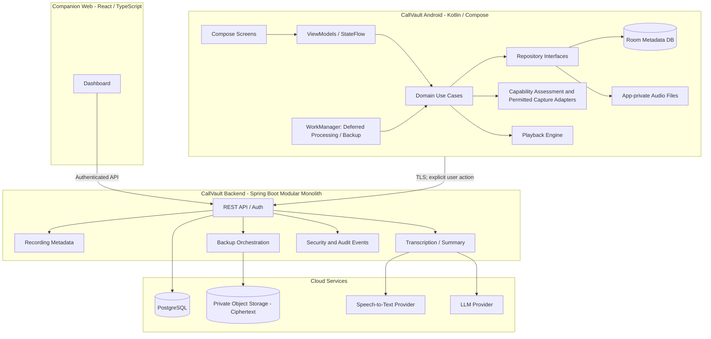

# CallVault — Product and Technical Specification

**Document:** `spec.md`  
**Version:** 1.0  
**Date:** 27 November 2026  
**Status:** Proposed system specification; implementation choices subject to the open decisions below

## 1. System overview

CallVault is an Android-first hybrid application with three equally central capabilities:

- **Capture:** microphone recording, user-selected audio import and only verified/permitted call-source adapters.
- **Manage:** local-first recording library, playback, metadata, search, export and optional backup.
- **Understand:** transcription, transcript retrieval, summaries, action items and later conversation Q&A.

The Android application owns device audio access and local files. A Spring Boot backend provides cloud APIs and AI/backup orchestration when those features are enabled. A React/TypeScript companion built with Lovable is a secondary client and cannot record Android calls.

## 2. Approved technology baseline

| Layer | Baseline | Notes |
|---|---|---|
| Android language | Kotlin | Native device integration |
| Android UI | Jetpack Compose + Material 3 | Native Android application |
| Android architecture | MVVM with Clean Architecture boundaries | UI → ViewModel → domain → repositories/data |
| Local database | Room | Offline metadata and job state |
| Local audio | App-private storage | Encryption-at-rest design to be finalized |
| Background work | WorkManager | Deferrable uploads/processing only; not a covert recording mechanism |
| Playback | AndroidX Media3 or platform APIs | Final choice after format/lifecycle evaluation |
| Backend | Java + Spring Boot 3.x modular monolith | Exact patch version pinned at implementation start |
| Cloud database | PostgreSQL | Structured metadata; never store raw audio blobs here |
| Object storage | Private S3-compatible storage or equivalent | Provider not selected |
| Web client | React + TypeScript, generated with Lovable | Uses documented authenticated APIs only |
| API | REST under `/api/v1`, OpenAPI | Versioned contracts |
| Build | Gradle Kotlin DSL for Android | Backend build tool to be selected once and standardized |

Existing project documents proposed minimum Android API 26 and a planning target of API 36 subject to then-current Play requirements. Treat both as provisional; re-check official platform and Play requirements before creating/releasing the final build.

## 3. Architectural principles

1. Android remains the authority for recording, permissions, file access and playback.
2. Local library and playback must function offline without sign-in.
3. Original audio is stored independently from transcript/summary outputs.
4. The backend begins as a modular monolith; do not introduce microservices without an operational need.
5. No audio is uploaded for AI or backup without a user-triggered, disclosed action.
6. Call-state metadata and call-audio capture are separate domains.
7. Capability claims are backed by repeatable test records, not API probing alone.
8. Any unsupported call source fails closed and remains clearly labelled unsupported/unverified.

## 4. High-level architecture



## 5. Android component specification

### 5.1 Presentation layer

Proposed destinations:
- Home
- Recordings / Library
- Recording Detail / Player
- Capture / Active Recording
- Recording Compatibility
- AI Insights / Transcript / Summary
- Backup
- Settings / Privacy

The UI must expose loading, empty, success, offline, permission denied, unsupported, unverified, processing, retryable failure, permanent failure, missing-file and deleted states.

### 5.2 Domain layer

Initial use cases:
- `StartMicrophoneRecording`
- `PauseRecording` / `ResumeRecording` where supported
- `StopRecordingAndFinalize`
- `ValidateAudioFile`
- `ImportAudioFile`
- `ListRecordings`
- `GetRecordingDetails`
- `PlayRecording` / `SeekPlayback`
- `RenameRecording`
- `DeleteRecording`
- `ExportRecording`
- `AssessRecordingCapabilities`
- `RequestTranscription`
- `RetryProcessingJob`
- `RequestSummary`
- `SearchLibrary`

Call-source integrations must be separate adapters behind a capability contract. Never let the UI call restricted audio sources directly.

### 5.3 Data layer

- Room DAOs and entities for local metadata.
- File repository for app-private audio.
- Import adapter using Storage Access Framework.
- Media playback adapter.
- Processing-job repository.
- API data source for cloud-enabled operations.
- Settings and privacy preferences repository.
- Mappers between domain, Room and API types.

### 5.4 Audio capture service

Use a foreground service only when required and permitted for an active, user-visible microphone capture session. It must:
- Start only after contextual explanation, permission and explicit user action.
- Provide visible notification/status and a stop action as required.
- Persist session state and recover partial files where possible.
- Treat Stop as terminal for that session.
- Finalize and validate the resulting file before marking it Complete.
- Handle microphone permission denial, audio focus loss, competing audio sessions, screen lock, app backgrounding, process recreation and service errors.

Do not assume `VOICE_CALL`, `VOICE_UPLINK`, `VOICE_DOWNLINK` or `CAPTURE_AUDIO_OUTPUT` are available to ordinary third-party applications. Do not use Accessibility API or a helper APK to work around this.

## 6. Domain model

The following is a logical model. Exact Kotlin/SQL fields may be adjusted during implementation without changing the product semantics.

### 6.1 Recording

```kotlin
data class Recording(
    val id: String,
    val title: String,
    val sourceType: RecordingSourceType,
    val sourceLabel: String?,
    val createdAt: Instant,
    val durationMs: Long?,
    val mimeType: String?,
    val codec: String?,
    val fileRef: String,
    val fileSizeBytes: Long?,
    val captureState: CaptureState,
    val integrityState: IntegrityState,
    val transcriptState: ProcessingState,
    val summaryState: ProcessingState,
    val backupState: BackupState
)

enum class RecordingSourceType { MICROPHONE, IMPORTED, VERIFIED_CALL_SOURCE }
enum class CaptureState { PREPARING, RECORDING, PAUSED, INTERRUPTED, FINALIZING, COMPLETED, FAILED }
enum class IntegrityState { PENDING, VALIDATED, SUSPECT, FAILED }
```

A verified call source must carry a separate capability/test record. `VERIFIED_CALL_SOURCE` is not a generic fallback for unknown audio.

### 6.2 Capability record

Fields:
- source identifier/type (for example, cellular SIM, specific VoIP application, microphone)
- status: `SUPPORTED`, `UNSUPPORTED`, `UNVERIFIED`, `NOT_APPLICABLE`
- tested device model and build/fingerprint where appropriate
- Android version/API
- target/source application version where relevant
- capture method and required permissions
- test date, test result and evidence reference
- limitations (for example, speakerphone-only or accessory-specific)

Live capability probes alone cannot prove that remote call audio is captured. Verification requires a controlled end-to-end test and a policy review of the method.

### 6.3 Transcript and summary

Transcript fields: ID, recording ID, language, provider/method, status, transcript segments, timestamps, speaker labels as estimates, edit history and creation time.

Summary fields: ID, recording ID, transcript ID, overview, topics, key points, decisions, action items, source/timestamp references, model/provider version, generated time and user edits.

### 6.4 Processing job

Fields: ID, recording ID, job type, status, provider job ID, progress, attempt count, idempotency key, timestamps, error category/code and retry eligibility. Do not store API credentials or raw audio in job records.

## 7. Local storage and file lifecycle

1. Create a durable temporary file before capture/import copy.
2. Write to a temporary filename while in progress.
3. On stop, flush/close the writer and move to a finalized managed location.
4. Validate container readability, codec, duration, plausible size and playback initialization.
5. Persist metadata and mark the item completed only after checks pass.
6. Preserve recoverable partial recordings after unexpected interruption.
7. Do not delete an external import source until the private copy is validated.
8. Use stable IDs and relative managed paths, not arbitrary absolute filesystem paths in Room.
9. Keep derived transcript/summary files/data separate from source audio.

File metadata can detect empty/truncated/corrupt outputs but cannot by itself prove that both sides of a conversation were captured.

Initial candidate import formats from the existing TRD: M4A/AAC, MP3, WAV, OGG/Opus. Confirm decoder support and add tests before advertising support.

## 8. Local database specification

Initial logical tables/entities:
- `recordings`
- `capability_results`
- `transcripts`
- `transcript_segments` (if segmentation requires a normalized table)
- `summaries`
- `processing_jobs`
- `tags`
- `recording_tags`
- `app_settings`

Use UUIDs, consistent UTC timestamps and Room migrations. The source-audio file reference is an app-private managed identifier/relative path. Store derived processing outputs separately. Add indexes for common library sort/search filters.

## 9. Backend modular monolith

Initial internal modules/packages:
- `identity` — registration/authentication/session
- `recordings` — synchronized metadata and ownership
- `transcription` — job API and provider orchestration
- `summaries` — LLM orchestration and output persistence
- `backup` — backup manifests, object authorization and restore state
- `audit` — privacy/security events without content logging
- `shared` — configuration, validation, error model and security

Backend boundaries:
- REST API versioned `/api/v1`.
- OpenAPI contract.
- PostgreSQL for metadata only.
- Private object storage for encrypted audio ciphertext.
- Authenticated ownership checks on every resource.
- Request validation, rate limits, upload type/size limits and idempotency.
- Background processing for transcription/summaries.
- Short-lived upload/download authorization where applicable.

Do not add microservices, queues or cloud vendors until an evidenced requirement warrants them.

## 10. AI processing pipeline

1. User selects a recording and requests a particular operation.
2. App displays what is being sent, destination/provider category, language/usage limits and retention summary.
3. User confirms.
4. App creates a durable local job and, if online/cloud-based, submits an idempotent backend request.
5. Upload, provider processing and result retrieval have separate progress states.
6. Provider output is validated and stored as derived data linked to the source audio.
7. User can inspect/edit/delete transcript and summary.
8. Retry resumes the job when safe; it does not re-record or silently duplicate billable work.

Provider selection is OPEN. Evaluate language quality (including intended user languages), latency, price per audio minute, file limits, diarization, data residency, retention/deletion, supported formats and terms before selection.

AI summary structure:
- Overview
- Key points/topics
- Decisions
- Action items (with assignee only when supported by transcript)
- Uncertainty/limitations
- Source transcript reference/timestamp where available

Conversation Q&A is deferred until retrieval quality is measurable. Responses must be grounded in the selected recording/transcript and admit when no answer is present.

## 11. Privacy and security design

- App-private audio storage by default.
- Android Keystore-backed protection for local key material.
- Use vetted cryptographic APIs/libraries; no custom cipher.
- If encrypting local audio, use authenticated encryption, unique nonce/IV per operation and documented key rotation/recovery.
- Cloud backup audio is encrypted client-side before upload; object storage receives ciphertext.
- TLS for all network traffic.
- No provider API keys in APK or web bundle.
- Secure token storage and short-lived access credentials.
- Redact logs, metrics and crash reports; never log raw transcript/audio content or secrets.
- Explicit controls for upload, sharing, retention, export and deletion.
- Key-loss limitations must be clear before enabling end-to-end encrypted backup.
- Privacy policy and Data Safety declarations must match actual implementation.

## 12. Backup and synchronization

Backup is optional and independent of recording and local playback. Proposed states:
`NOT_CONFIGURED`, `QUEUED`, `ENCRYPTING`, `UPLOADING`, `BACKED_UP`, `FAILED`, `RESTORE_QUEUED`, `RESTORING`, `RESTORED`.

Requirements:
- Encrypt audio locally before upload.
- Upload only ciphertext for backed-up audio.
- Store hash, size and object metadata.
- Retry transient failures with bounded backoff and idempotency.
- Restore and verify integrity before registering restored files.
- Handle deleted local items, deleted cloud objects and conflicts predictably.
- Decide key recovery/multi-device key access before claiming cross-device restore.

## 13. Web companion

- React + TypeScript, generated initially with Lovable.
- Desktop-first responsive library/detail experience; mobile responsive layout.
- Uses the same authenticated API contracts as Android.
- Displays only cloud-synchronized/authorized content.
- Shows local-only versus backed-up/synchronized states.
- Can display audio, transcript, summaries and metadata when access has been authorized.
- No web cellular call recording or browser-based claims that imply access to phone call audio.

## 14. API outline (not final contract)

Potential resource groups:
- `/api/v1/auth/*`
- `/api/v1/recordings` — synchronized metadata
- `/api/v1/recordings/{id}`
- `/api/v1/recordings/{id}/transcriptions`
- `/api/v1/recordings/{id}/summaries`
- `/api/v1/processing-jobs/{id}`
- `/api/v1/backups` and `/api/v1/backups/{id}/restore`
- `/api/v1/account/export` and `/api/v1/account/deletion`

Do not implement these endpoints until authentication, ownership, upload, retention and error contracts are defined. Local-only MVP should not require backend APIs.

## 15. Testing and quality strategy

### Unit tests
- Domain state transitions and use cases.
- File validation and metadata mapping.
- Recording and processing state reducers.
- Repository and retry/idempotency logic.
- Summary parsing/validation.

### Android instrumentation tests
- Room DAOs and migrations.
- Storage Access Framework import.
- Playback and lifecycle transitions.
- Screen-off/background microphone capture.
- Permission denied and audio-focus conflict paths.
- Stop terminality and no unexpected restart.
- Empty, truncated, corrupt and missing file recovery.
- Export and delete semantics.

### Device matrix

| Device | OS | Role | Status |
|---|---|---|---|
| OnePlus 10T 5G | Android 15 | Primary early test device | Not yet tested in this research package |
| Recent Pixel device | Version to record during testing | Comparison device | Not tested |
| Other OEM device | Device/version to select | OEM variation | Not tested |

Record each source independently. Do not extrapolate a result from one device to another.

### Backend tests
- Authentication and per-user ownership.
- API validation, upload authorization and limits.
- Database migrations.
- AI provider failure, retry, cancellation and duplicate request handling.
- Backup ciphertext/integrity/restore.
- Deletion propagation.

## 16. Open technical decisions

1. Local audio at-rest encryption implementation and key recovery.
2. Minimum and target Android SDK for release.
3. Exact foreground service type/permission and notification behaviour required for target API.
4. Playback engine and supported formats.
5. Speech-to-text and LLM provider(s), including on-device alternatives.
6. Backend build tool and migration tool.
7. Auth mechanism and identity provider.
8. Cloud object storage provider, region and deletion guarantees.
9. API job orchestration mechanism.
10. Call-source integrations, if any, after policy and device feasibility testing.
11. Whether web companion is included in first public release or a later release.

## 17. Definition of technical readiness

- Reproducible Android/backend builds.
- Dependencies pinned and compatible.
- Unit/instrumentation/integration tests passing.
- No secrets in source control or client binaries.
- Recording lifecycle is transparent, user-controlled and recoverable.
- Local original audio remains accessible through all AI failures.
- No unsupported capture source is claimed as supported.
- Threat model, permission review, privacy review and release policy review completed.
