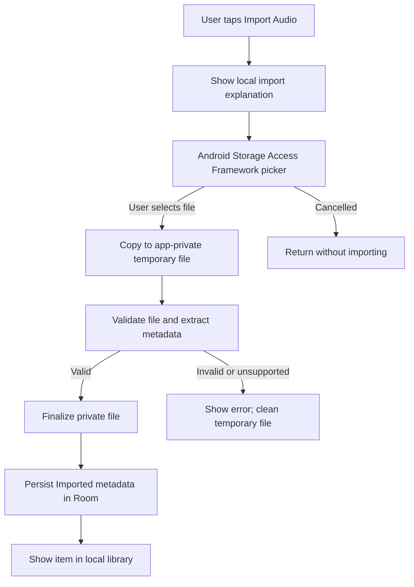
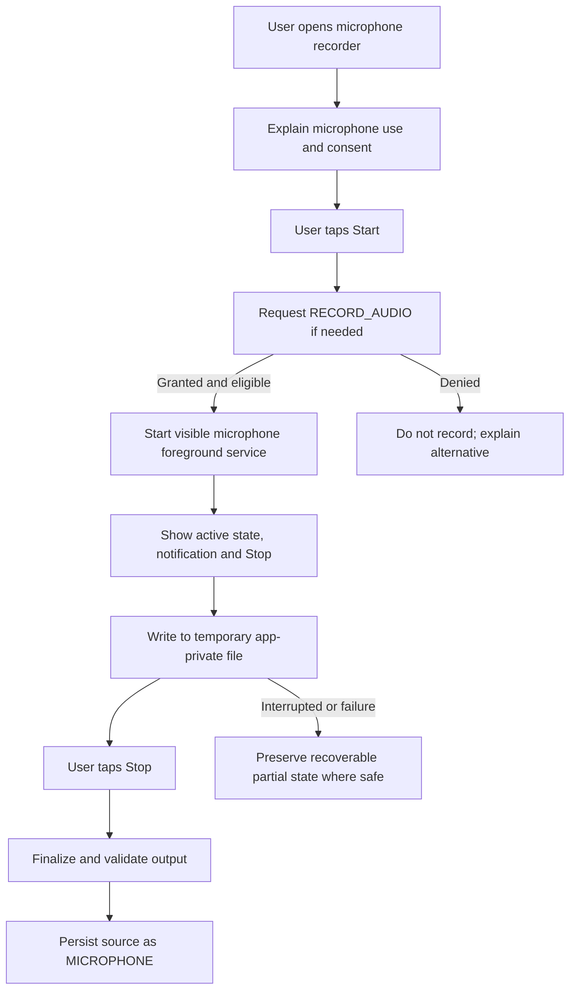
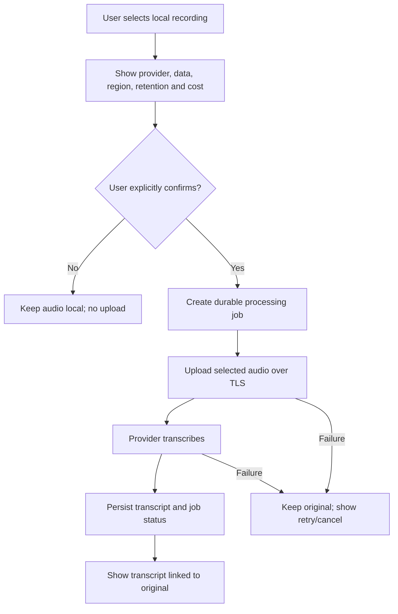
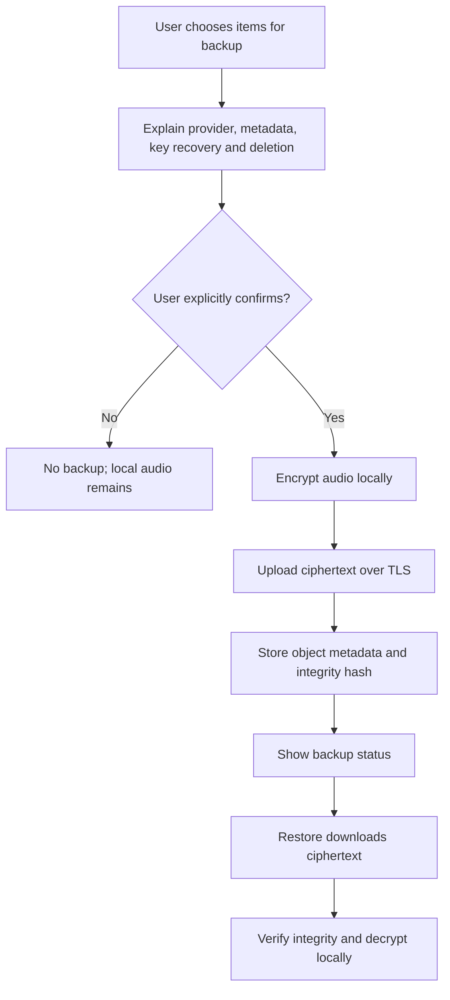

# CallVault — Privacy Disclosures, Consent and Data Flows

**Baseline:** 27 November 2026  
**Status:** Proposed product/UX and data-flow baseline for review; no cloud or recording flow is implemented by this document.  
**Traceability:** T-005, CV-005, CV-007, CV-012.

## 1. Privacy design rules

1. Local import, local library and playback do not require an account or network.
2. Selecting a file through Android's Storage Access Framework is a user-directed import. Label it Imported; do not describe it as recorded by CallVault.
3. Microphone recording, if approved as a product feature, must be explicitly started by the user from a visible UI, show an ongoing system notification/recording state and provide an immediate stop action.
4. Call-state metadata must never be described as call-audio access.
5. No SIM or third-party VoIP recording is offered unless a specific permitted source is independently verified and policy-reviewed.
6. No audio leaves the device for AI or backup until the user has seen a point-of-use disclosure and taken a distinct affirmative action.
7. AI transcripts, summaries and embeddings are derived data. They never replace or silently delete the original audio.
8. No consent is inferred from navigation, dismissal, inactivity or a previously accepted unrelated disclosure.
9. Permission requests follow the relevant explanation and only appear when the user invokes the feature.
10. Retention, provider, processing region and deletion behavior must be filled with actual values before cloud processing ships; placeholders are not acceptable in production.

## 2. Proposed point-of-use disclosure copy

These are draft UX strings. Final copy requires the actual implementation, provider contracts, retention decisions and legal review.

### A. Import audio

**Title:** Import audio to CallVault

**Body:** You choose an audio file using Android's file picker. CallVault copies the selected file into its private app storage and saves its details in your local library. The original file you selected is not uploaded by this action.

**Action:** Import selected file

**Boundary:** No microphone or call-recording permission is required for this SAF import flow.

### B. Microphone recording — only if approved and implemented

**Title:** Record with your microphone

**Body:** CallVault will use this device's microphone while recording is active. Recording starts only after you tap Start. An ongoing recording indicator and stop control will remain available. This records microphone input; it does not provide access to internal SIM-call or third-party VoIP audio. Make sure you have the required consent and legal authority before recording anyone.

**Actions:** Start recording / Not now

**Permission sequence:** Show this disclosure, obtain affirmative in-app action, then request Android RECORD_AUDIO at the point of use. If permission is denied, do not start capture and provide a safe alternative.

### C. AI transcription / cloud processing

**Title:** Send this recording for transcription?

**Body template:** If you continue, CallVault will upload the selected recording [recording title] to [named service/provider] in [processing region] to create a transcript. The provider may process [audio and required metadata] under [linked retention/deletion terms]. This is optional. Your original local recording remains in CallVault if processing fails. Review the provider and retention details before continuing.

**Required UI facts before release:** provider legal name; destination/region; exact data sent; provider retention/deletion terms; whether provider uses data for model training; expected cost/quota; cancellation and deletion behavior.

**Actions:** Upload and transcribe / Cancel

### D. Encrypted backup

**Title:** Enable encrypted backup?

**Body template:** CallVault will encrypt selected audio on this device before uploading it to [named storage provider]. The service receives encrypted audio and the metadata explicitly listed here. Your encryption key is protected using [approved key design]. [Explain recovery and device migration limitations in plain language.] Backup is optional and can be paused or disabled.

**Required UI facts before release:** storage provider; regions; metadata uploaded; encryption format and key wrapping; recovery method; lost-key consequences; retention and deletion propagation; restore behavior.

**Actions:** Enable backup / Not now

## 3. Local import data flow

**Data boundary:** file bytes and metadata remain on device. No account, network, AI provider or backup service is involved.

## 4. Microphone recording data flow — proposed, not implemented

**Boundary:** this is microphone input only. It is not an adapter for SIM-call or third-party VoIP internal audio. Implement only after product scope, foreground-service declarations, consent and device tests are approved.

## 5. AI processing data flow — future

**Boundary:** original audio is never deleted because transcription failed. Upload and transcription progress are separate states.

## 6. Encrypted backup data flow — future

**Boundary:** plaintext audio must not be uploaded to object storage. Key recovery and device migration must be designed before enabling backup.

## 7. Data inventory and default boundary

| Data | Local by default | Leaves device only when | Required disclosure |
|---|---|---|---|
| Imported original audio | Yes | User explicitly requests AI processing or backup | Selected file, destination, purpose and whether original remains local |
| Microphone recording | Yes, if feature is implemented | User separately requests AI processing or backup | Microphone use, active duration/state, destination and consent |
| Recording metadata | Yes | Explicit synchronization/backup feature | Exact metadata fields, account association and destination |
| Transcript | Yes after processing result is received | Explicit sync/backup, if supported | Transcript content, provider, retention and deletion |
| Summary/bookmarks/notes | Yes | Explicit sync/backup, if supported | Content and destination |
| Diagnostics/crash data | Minimize | Only according to disclosed diagnostics configuration | Fields, SDKs, purpose and retention |
| Encryption keys | Device/user controlled | Never upload plaintext keys; only approved wrapped key material if design requires | Recovery model and consequences |

## 8. Decisions still required before release

- Recording jurisdictions and participant-consent requirements for every launch market.
- Whether microphone recording is part of the first local release or deferred.
- Exact transcription provider, processing region, retention, deletion and model-training terms.
- Whether metadata/transcripts synchronize independently from audio.
- Backup object-storage provider, encryption format, key wrapping, recovery and device migration.
- Default retention and deletion propagation across local files, Room, provider jobs and cloud objects.
- Privacy policy owner/contact and support process.
- Final Play Data Safety declarations based on the actual shipped SDKs and behavior.

## 9. Acceptance checklist

- [ ] Every sensitive-data flow has a point-of-use disclosure before permission or consent.
- [ ] Consent requires an affirmative action and is specific to the flow.
- [ ] Denial/cancellation leaves local data intact and does not block unrelated local features.
- [ ] Active microphone capture, if implemented, has a visible indicator and immediate stop control.
- [ ] No call-state event is represented as audio capture.
- [ ] No audio upload occurs from import or local playback.
- [ ] AI upload names the provider, destination, data, retention and cost/quota before confirmation.
- [ ] Backup disclosure explains client-side encryption and key recovery before activation.
- [ ] Privacy policy and Play Data Safety statements match actual implementation and SDK behavior.
- [ ] Deletion and retention behavior is tested end to end before cloud release.
